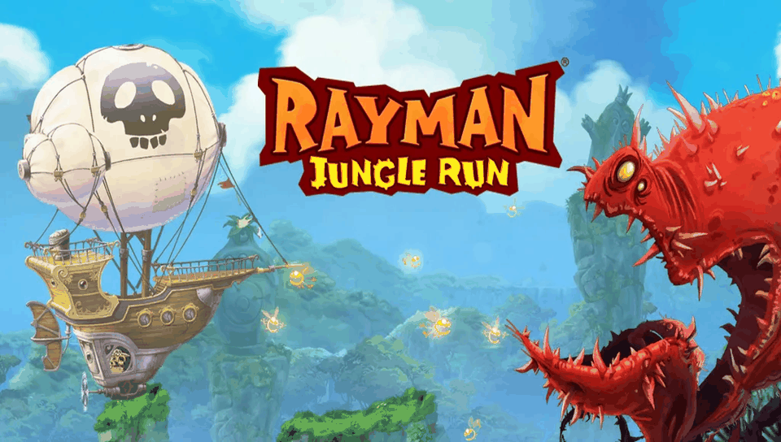

<h1 align="center">
  <br>
  Rayman Jungle Run · PS Vita Port
</h1>

<p align="center">
  <b>Native port of Rayman Jungle Run (Ubisoft Montpellier / PastaGames) for PlayStation Vita and PlayStation TV.</b>
</p>

<p align="center">
  
  
  
  
  
  
</p>

<p align="center">
  <a href="#-description">Description</a> •
  <a href="#-features">Features</a> •
  <a href="#-controls">Controls</a> •
  <a href="#-installation">Installation</a> •
  <a href="#-known-issues">Known Issues</a> •
  <a href="#-building-from-source">Build</a> •
  <a href="#-credits">Credits</a>
</p>

---

## 📖 Description

An enhanced, native port of **Rayman Jungle Run** (Android) for the **PlayStation Vita** and **PlayStation TV**, powered by an ARMv7 dynamic shared library loader (`so-loader`) and custom `FalsoJNI` bridge. The game's `libRO1Mobile.so` and `libfmodex.so` run natively on the Vita's CPU; the game's own assets are read from `ux0:data/raymanjunglerun/`.

---

## 🎮 Status & Playability

**Status: Playable (v1.2.0)** — the full game is playable on PS Vita: level progress and settings are saved and
restored, and the trophy set installs on the console. Release notes: [`RELEASE_v1.2.md`](RELEASE_v1.2.md)
(and [`RELEASE_v1.0.md`](RELEASE_v1.0.md), [`RELEASE_v1.1.md`](RELEASE_v1.1.md) for earlier versions).

- [x] **Save progress loads**: the save-read bug (progress reset on every launch) is fixed in v1.1.0 and was resolved on console. *Verified on console.*
- [x] **Boots and plays**: the data-abort at start-up caused by the `ManyWorldsMenu` carousel patch was resolved on console. *Verified on console.*
- [x] **Audio**: FMOD Ex with Ogg Vorbis streaming for music, cached SFX. *Verified on console.*
- [x] **Input**: physical buttons, D-Pad, left analog stick and front touch screen.
- [x] **Trophies (install)**: the 19-trophy set installs on the console (`Trophy state loaded: count=19`, `port_progress.md`, log 020).
- [ ] **Trophies (unlock sync)**: the v1.2.0 ID mapping and existing-save sync are not yet confirmed on console <!-- TODO: confirm on hardware -->.
- [ ] **Performance**: frame drops remain in some scenes (see [Known Issues](#-known-issues)).

### 📋 Changelog

- **v1.2.0**: native PS Vita trophies (19 trophies: 12 Bronze, 3 Silver, 3 Gold, 1 Platinum; see [Trophies](#-trophies)); achievements already earned in an existing save are synced on the next load/save.
- **v1.1.0**: progress now loads correctly (the engine's file loader read the error bit at the wrong offset of the SceLibc `FILE` struct, so every save read failed); CPU clock raised (see [Known Issues](#-known-issues) for the clock figure).
- **v1.0.1**: the `saves/` folder is created automatically on launch.
- **v1.0**: first release. Saves were written but the folder was not created, so the game could fail to save.

---

## ✨ Features

| Feature | Status | Notes |
| :--- | :---: | :--- |
| Boots to gameplay | ✅ | Full game with all 70 levels, worlds 6 & 7 (CASA DLC), skins, gallery and dead-man stages unlocked |
| Graphics / renderer | ✅ | vitaGL, GLES 2.0 with GLES 1 fixed-pipeline calls; native 960×544 |
| Audio & music | ✅ | FMOD Ex with Ogg Vorbis streaming for music tracks and cached SFX |
| Video / cutscenes | ➖ | The game has no videos in its assets |
| Physical buttons | ✅ | Buttons and D-Pad; see [Controls](#-controls) |
| Analog sticks / camera | ✅ | Left stick navigates menus and moves the hero |
| Touch screen | ✅ | Full touchscreen controls and UI interaction |
| Button remapping / port menu | ➖ | Not documented in this port |
| Save data | ✅ | Level progress, selected hero and settings in `ux0:data/raymanjunglerun/saves/` |
| Native trophies | 🟡 | 19 trophies install on console; unlock sync for v1.2.0 pending confirmation (see [Trophies](#-trophies)) |
| Languages | 🧪 | The game ships `*.lproj/` folders (e.g. `en`, `es`); not separately tested |
| Performance | 🟡 | Targets 60 FPS; some heavy scenes still drop frames; shader cache reduces stutter |
| Online / IAP / ads | 🧪 | In-app purchase prompts are bypassed to unlock content; not confirmed on console |
| PS TV | 🧪 | Listed in the platform badge; no separate PS TV test recorded |

Legend: `✅ Working (verified on console) · 🧪 Implemented, not yet verified on console · 🟡 Partial · ❌ Not working · ➖ Not applicable · ❔ Not documented yet`

### Details

- **Native Resolution & 60 FPS target:** Runs at full Vita native resolution (960x544) targeting 60 FPS (some heavy scenes still drop frames, see Known Issues).
- **Full High-Fidelity Audio:** Native implementation of FMOD Ex with Ogg Vorbis streaming and sample caching, playing all original music tracks and sound effects without distortion or missing audio.
- **Full Game Unlocked:** All 70 levels, worlds 6 & 7 (CASA DLC), character skins, gallery wallpapers and dead-man stages are fully unlocked out of the box (in-app purchase prompts bypassed).
- **Native PS Vita Trophies:** All 18 in-game achievements (Lums, Teeth of Death, Stubborn...) plus a Platinum, shown with the system notification and in the Trophies app. Achievements already earned in an existing save are synced on the next load/save (new in v1.2.0, requires NoTrpDrm).
- **Persistent Saves:** Level progress, selected hero and settings are saved and restored between sessions (fixed in v1.1.0).
- **Physical Gamepad & Front Touch:** Full integration with PS Vita hardware controls (Buttons, D-Pad, Left Analog Stick) plus native front touchscreen support.
- **Shader Cache:** Runtime GXP shader binary caching on storage (`ux0:data/raymanjunglerun/gxp/`) eliminating recompilation stutters.
- **Optimized Memory & I/O:** Uses SceLibcBridge with custom sample memory management to respect PS Vita kernel file descriptor limits (`EMFILE` safe).

---

## 🎯 Controls

| Vita input | Action |
| :--- | :--- |
| **Cross ($\times$)** | Jump / Hover / Confirm / Start level ("GO") |
| **Square ($\square$)** | Punch / Attack |
| **Circle ($\bigcirc$)** | Back / Cancel |
| **Left Stick / D-Pad** | Navigate Menus / Move |
| **Start** | Pause Game / Return to Menu |
| **Touchscreen** | Full Touchscreen Controls & UI Interaction |

---

## 🏆 Trophies

- **19 trophies** (12 Bronze, 3 Silver, 3 Gold, 1 Platinum), mapped to the game's 18 achievements plus the Platinum, which the system awards once the other 18 are earned. Requires **NoTrpDrm** (see [Prerequisites](#-prerequisites)); without it the game runs normally, just without trophies.
- Achievements include total Lums, Lums in one run, Teeth of Death per world, and the "Stubborn!" retry/death ones.
- The trophy set installs on first launch and appears in the Trophies app. Unlocks show the standard system notification.
- **Existing saves are synced** (v1.2.0): the game reports each achievement only once and remembers it in its save, so achievements earned before v1.2.0 would never reach the trophy system. After every save/load the port sends any achievement already marked in the save.

---

## 📋 Prerequisites

Make sure your PS Vita is running Henkaku / Enso on firmware 3.60 or 3.65 and has the following plugins installed:

1. **[kubridge.skprx](https://github.com/TheOfficialFloW/kubridge/releases)** (v0.3.1 or higher)
2. **[fd_fix.skprx](https://github.com/TheOfficialFloW/FdFix/releases)** (or repatch / rePatch reLoaded)
3. **libshacccg.suprx** runtime shader compiler (can be easily extracted using **[ShaRKBR33D](https://github.com/Rinnegatamante/ShaRKBR33D)**).
4. **[NoTrpDrm.suprx](https://github.com/Rinnegatamante/NoTrpDrm/releases)** under `*main` in `ur0:tai/config.txt` (optional, only needed for trophies; reboot after installing).

---

## 📦 Installation

1. Install the latest **`raymanjunglerun.vpk`** on your PS Vita using VitaShell.
2. Obtain a legally purchased copy of **Rayman Jungle Run** (v1.3.x or compatible ARMv7 build) in `.apk` format.
3. Open the `.apk` file using an archive manager (such as 7-Zip, WinRAR, or unzip).
4. Extract the following native libraries from `lib/armeabi-v7a/`:
   - `libRO1Mobile.so`
   - `libfmodex.so`
5. Extract the game asset files:
   - In most APK versions, the main game assets are inside `assets/` (or packed inside an internal zip file such as `assets/LUGndna...`).
   - Extract the entire `files/` folder (containing `gfx/`, `pasta/`, `sfx/`, `*.lproj/`, etc.).
6. Copy the extracted files to your PS Vita storage under `ux0:data/raymanjunglerun/`:
   ```
   ux0:data/raymanjunglerun/
   ├── libRO1Mobile.so
   ├── libfmodex.so
   └── files/
       ├── en.lproj/
       ├── es.lproj/ (and other languages)
       ├── gfx/
       ├── pasta/
       └── sfx/
   ```
7. Launch **Rayman Jungle Run** from your LiveArea!

### Final File Structure in `ux0:data/raymanjunglerun/`

```text
ux0:data/raymanjunglerun/
├── libRO1Mobile.so   <- Native game library from lib/armeabi-v7a/ in the APK
├── libfmodex.so      <- FMOD library from lib/armeabi-v7a/ in the APK
├── files/            <- Game assets (en.lproj/, es.lproj/, gfx/, pasta/, sfx/, ...)
├── saves/            <- Save slots (created automatically from v1.0.1)
├── gxp/              <- Shader cache (created at runtime)
└── logs/             <- Incremental logs (fetch these when reporting a bug)
```

### 💾 Save Data

Saves are stored in `ux0:data/raymanjunglerun/saves/` (`slot1.dat`, `secondarySave`, `ROHeroe`, `Achievements`, ...).

- **v1.0.1 and later** create the `saves/` folder automatically on launch.
- **v1.0 did not create it**, so the game silently failed to save. If you are on v1.0, update, or create the folder manually with VitaShell: `ux0:data/raymanjunglerun/saves/`.
- **v1.0.x wrote saves but never loaded them back** (progress appeared reset on every launch). **v1.1.0 fixes this**; existing `slot1.dat` files load as-is.
- Progress played on v1.0 *before* that folder existed was never written to disk and cannot be recovered.
- On first launch with a new save, select your save slot from the main menu so the game loads it.

---

## 🐛 Known Issues

- **Frame drops in some scenes** (e.g. World 2 during the Choplifter / flying sequences). v1.1.0 raises the CPU clock to 500 MHz to reduce them; still under investigation. <!-- TODO: confirm the clock; `port_progress.md` lists 444 MHz CPU / 222 MHz GPU / 222 MHz / 166 MHz overclock values. -->
- If progress still resets on v1.1.0, please open an issue attaching the latest file from `ux0:data/raymanjunglerun/logs/` and your `saves/` folder.
- **Reported progress reset on v1.0**: a user report of world 1 progress being reset when reaching world 2 (v1.0 with the folder created by hand) has no log attached and is not reproduced in the port notes.
- **Logs** are written to `ux0:data/raymanjunglerun/logs/`. **Crash dumps** are written by the system to `ux0:data/` (not to the game folder).

---

## 🔨 Building from Source

To compile the port yourself using the official **[vitaSDK](https://vitasdk.org/)**:

```bash
git clone https://github.com/MetalSyntax/Rayman-Jungle-Run-vita.git
cd Rayman-Jungle-Run-vita

export VITASDK=/path/to/vitasdk
export PATH=$VITASDK/bin:$PATH

cmake -B build -S . -DCMAKE_TOOLCHAIN_FILE=$VITASDK/share/vita.toolchain.cmake -DCMAKE_BUILD_TYPE=Release
cmake --build build -j$(nproc)
```

The resulting `raymanjunglerun.vpk` and `eboot.bin` will be located in the `build/` directory.

---

## 📁 Project Structure

- `source/`: Native loader and reimplementations (lifecycle, audio, input, trophies, FalsoJNI bridge, patches).
- `lib/`: Auxiliary libraries (SO loader, FalsoJNI, libc bridge and related helpers).
- `extras/`: LiveArea assets (`icon0.png`, `pic0.png`, and related files).
- `decompiled/`: Analysis notes of the original Android library.
- `RELEASE_v1.0.md`, `RELEASE_v1.1.md`, `RELEASE_v1.2.md`: Release notes.
- `PORTING_PLAN.md`: Living plan and architecture notes. `port_progress.md`: Bug-by-bug progress log.

---

## 📜 Disclaimer

**Rayman Jungle Run** is the property of its owners (Ubisoft Montpellier and PastaGames, as credited below). The work presented in this repository is unofficial and is not produced, endorsed, or sanctioned by Ubisoft, PastaGames or any affiliated entities.

This software does NOT contain original game code, binaries, copyrighted graphics, or game assets. The authors do not promote or condone piracy in any way. To play, you must provide your own legally obtained copy of the game in the form of an `.apk` file.

---

## ☕ Support My Work

This project is **free** and will stay free. If you enjoy it, a tip from **$1** helps me keep porting games to the PS Vita:

<p align="center">
  <a href="https://ko-fi.com/metalsyntax"></a>
</p>

- **Ko-fi:** [ko-fi.com/metalsyntax](https://ko-fi.com/metalsyntax)
- **PayPal:** [paypal.me/MetalSyntax](https://paypal.me/MetalSyntax)
- **Bitcoin (BTC):** `133HdCsaWxdjTfmwpgGVykByhNBV338uRc`

**Ko-fi supporters get:**
- **Early access** to new ports before their public release (test builds of upcoming projects).
- **Data preparation scripts and step-by-step guides** to set up your own game files for each new port.
- A say in which games I port next.

> Game files are never distributed. You always need your own legally obtained copy of the game.

---

## 👥 Credits

- **Ubisoft Montpellier & PastaGames** for creating *Rayman Jungle Run* and the UbiArt / Pasta framework.
- **TheFloW** for the original `so-loader` concept and `kubridge`.
- **Rinnegatamante** for [vitaGL](https://github.com/Rinnegatamante/vitaGL) and invaluable contributions to the PS Vita homebrew scene.
- **Volodymyr Atamanenko** for the soloader boilerplate architecture and tooling foundations.
- Special thanks to the PS Vita homebrew and porting community.

---

## 📄 License

This software may be modified and distributed under the terms of the MIT license.
See the [LICENSE](LICENSE) file for details (`Copyright (C) 2021 Andy Nguyen`, as stated in that file).
